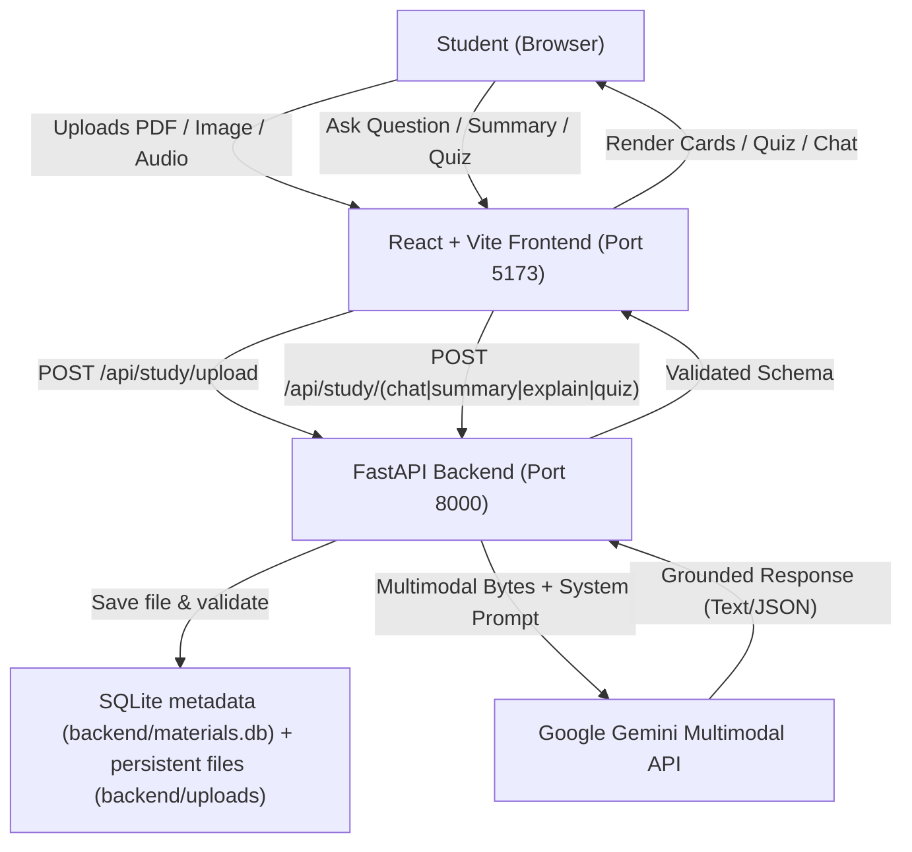

# EduMind AI Lite – Multimodal AI Study Assistant 🎓🤖

An intelligent, full-stack educational web application that empowers students to comprehend and master their study materials using Google Gemini multimodal AI.

---

## 🌟 Overview

**EduMind AI Lite** transforms static notes, textbook diagrams, and recorded audio lectures into an interactive, conversational learning environment. Instead of generic AI chatbots that lack academic context, EduMind AI grounds every answer, summary, and quiz directly in the student's uploaded material.

### 🎯 Key Highlights
- **Tri-Modality Support:** Native understanding of **PDF documents**, **visual diagrams/notes (PNG, JPG, WEBP)**, and **audio recordings (MP3, WAV, M4A, OGG)**.
- **Zero Hallucination Guardrails:** AI answers are grounded strictly in the uploaded context with explicit acknowledgment when information is outside the material.
- **Real-Time Gemini Multimodal Integration:** Built on the official Google GenAI Python SDK (`google-genai`) using Gemini Flash multimodal models.
- **Interactive Quiz Engine:** Generates exactly 5 exam-grade MCQs with single-question view, delayed scoring, and review mode with explanations.
- **Enterprise-Grade UI/UX:** Clean SaaS aesthetic designed for college project demonstrations and production study workflows.

---

## 🚀 Features

### 1. Modern Learning Dashboard
- Quick modality upload cards for **PDF**, **Image**, and **Audio**.
- Real-time session stats (Uploaded materials count, Quizzes completed).
- Quick action cards for **Ask AI Tutor**, **Generate Summary**, **Beginner Breakdown**, and **Generate 5 MCQs**.
- Recent materials gallery with instant jump actions.

### 2. Robust Multimodal File Upload
- Drag-and-drop & native file browser.
- Multi-format validation: `.pdf`, `.png`, `.jpg`, `.jpeg`, `.webp`, `.mp3`, `.wav`, `.m4a`, `.ogg`.
- Max file size guard: 20MB per file with upload progress indicators.
- In-browser previews:
  - High-resolution image preview lightbox.
  - Native HTML5 audio player for lecture playback.
  - PDF document preview & metadata extraction.
- Material deletion & cleanup.

### 3. AI Study Assistant & Chat
- Contextual multi-turn chat grounded in the active study material.
- User and AI message bubbles with timestamps and copy-to-clipboard.
- Auto-scroll and typing indicators.
- Quick suggested prompts for fast inquiry.
- Clear conversation option.

### 4. High-Yield Summary Generator
- Structured study overview:
  - **Main Subject / Topic**
  - **Important Concepts**
  - **Key Takeaways & Points**
  - **Essential Academic Definitions**
  - **Real-World Examples & Applications**
  - **Quick Exam Revision Notes**

### 5. Explain Like I'm a Beginner (Feynman Technique)
- Simplifies complex topics without technical jargon.
- Intuitive real-life analogies.
- Step-by-step breakdown.
- Key takeaways to remember before exams.

### 6. Interactive 5-Question Quiz Generator
- Exactly 5 MCQs formulated from the uploaded content.
- 4 plausible options per question (A, B, C, D).
- One-question-at-a-time interactive view.
- Anti-spoiler design: correct answers remain hidden until submission.
- Instant score calculation and percentage grade.
- Comprehensive review mode highlighting correct answers and educational explanations.
- Retake quiz capability.

---

## 🛠️ Technology Stack

| Component | Technology | Description |
|---|---|---|
| **Frontend** | React 18 + Vite | Lightning-fast build tooling and reactive UI |
| **Routing** | React Router v6 | Single Page Application (SPA) client routing |
| **Icons** | Lucide React | Modern, clean vector iconography |
| **HTTP Client** | Axios | API communication with upload progress tracking |
| **Backend** | Python 3.10+ / FastAPI | High-performance asynchronous API framework |
| **Server** | Uvicorn | ASGI web server implementation |
| **AI SDK** | `google-genai` | Official Google GenAI Python SDK |
| **AI Model** | Google Gemini (`gemini-2.5-flash`) | State-of-the-art multimodal reasoning |
| **Data Validation**| Pydantic v2 | Robust request/response schema serialization |

---

## 🏛️ System Architecture

Material metadata is stored in SQLite at `backend/materials.db`; uploaded binary files remain in `backend/uploads/`. Existing UUID-named uploads are imported into SQLite on startup when possible. This prevents metadata loss on API restarts and ensures all study endpoints resolve the same material record.



---

## 📁 Project Folder Structure

```
edumind-ai/
├── backend/
│   ├── app/
│   │   ├── __init__.py
│   │   ├── main.py                 # FastAPI application & middleware
│   │   ├── config.py               # Environment configuration
│   │   ├── routes/
│   │   │   ├── __init__.py
│   │   │   ├── health.py           # GET /api/health
│   │   │   └── study.py            # Upload, Chat, Summary, Explain, Quiz APIs
│   │   ├── services/
│   │   │   ├── __init__.py
│   │   │   ├── file_service.py     # File validation, SQLite metadata, durable file lookup
│   │   │   ├── gemini_service.py   # Google GenAI SDK multimodal integration
│   │   │   └── prompt_service.py   # Educational tutor prompts & schemas
│   │   └── schemas/
│   │       ├── __init__.py
│   │       └── study.py            # Pydantic validation models
│   ├── uploads/                    # Persistent uploaded file directory
│   ├── materials.db                 # SQLite metadata (created automatically)
│   ├── requirements.txt            # Python dependencies
│   ├── test_api.py                 # Automated backend test suite
│   └── .env.example                # Environment variables template
├── frontend/
│   ├── public/
│   ├── src/
│   │   ├── components/
│   │   │   ├── Header.jsx          # Top navigation & API status pill
│   │   │   ├── Sidebar.jsx         # Sidebar navigation
│   │   │   ├── UploadCard.jsx      # Modality upload cards
│   │   │   ├── FileUploader.jsx    # Drag-and-drop uploader & preview
│   │   │   ├── ChatWindow.jsx      # Interactive chat container
│   │   │   ├── ChatMessage.jsx     # Markdown message bubble renderer
│   │   │   ├── SummaryPanel.jsx    # Structured summary component
│   │   │   ├── QuizCard.jsx        # 5-question interactive quiz
│   │   │   ├── LoadingState.jsx    # Animated loading indicator
│   │   │   └── Toast.jsx           # Toast notification provider
│   │   ├── pages/
│   │   │   ├── Dashboard.jsx       # Main landing dashboard
│   │   │   ├── StudyAssistant.jsx  # Multi-tab AI study workspace
│   │   │   ├── Materials.jsx       # File gallery & management
│   │   │   ├── QuizGenerator.jsx   # Dedicated quiz practice view
│   │   │   └── About.jsx           # Project documentation & demo guide
│   │   ├── services/
│   │   │   └── api.js              # Centralized Axios API client
│   │   ├── styles/
│   │   │   ├── global.css          # Design tokens, variables & typography
│   │   │   └── components.css      # Component-level styling
│   │   ├── App.jsx                 # Routing & state management
│   │   └── main.jsx                # React DOM entry point
│   ├── index.html
│   ├── vite.config.js              # Vite server & backend proxy
│   └── package.json                # Frontend dependencies
├── .gitignore
└── README.md
```

---

## ⚙️ Prerequisites

1. **Python 3.10 or higher** (Python 3.14+ supported).
2. **Node.js (v18 or higher)** and `pnpm` (or `npm`).
3. **Google Gemini API Key** (Free from [Google AI Studio](https://aistudio.google.com/)).

---

## 🔑 Obtaining & Configuring Your Gemini API Key

1. Go to **[Google AI Studio](https://aistudio.google.com/)**.
2. Sign in with your Google account.
3. Click on **"Get API key"** and create a new key.
4. In the project root, open `backend/.env` (create it by copying `backend/.env.example`).
5. Paste your API key:
   ```env
   GEMINI_API_KEY=AIzaSyYourActualGeminiApiKeyHere
   GEMINI_MODEL=gemini-2.5-flash
   FRONTEND_ORIGIN=http://localhost:5173
   MAX_UPLOAD_MB=20
   ```
   *(Note: You can also use `gemini-2.0-flash` or `gemini-1.5-flash` depending on your account's regional availability).*

---

## 🚀 Installation & Running

Copy `backend/.env.example` to `backend/.env` and set a private `GEMINI_API_KEY`. Never commit or share `backend/.env`.

Open **two separate Windows PowerShell windows** (one for Backend, one for Frontend):

### Window 1: Start Backend (FastAPI)

```powershell
# Navigate to the backend directory
cd C:\Users\Yalaguresh\AI\edumind-ai\backend

# Install dependencies
python -m pip install -r requirements.txt

# Run automated test suite to verify health & endpoints
python test_api.py

# Start the FastAPI server on port 8000
python -m uvicorn app.main:app --host 127.0.0.1 --port 8000 --reload
```
*Backend will be running at:* `http://127.0.0.1:8000`  
*Interactive Swagger API Docs:* `http://127.0.0.1:8000/docs`

---

### Window 2: Start Frontend (React + Vite)

```powershell
# Navigate to the frontend directory
cd C:\Users\Yalaguresh\AI\edumind-ai\frontend

# Install dependencies (using pnpm or npm)
pnpm install

# Start the Vite development server
pnpm run dev
```
*Frontend will be running at:* `http://localhost:5173`

---

## 📡 API Endpoints Reference

| Method | Endpoint | Description |
|---|---|---|
| `GET` | `/api/health` | Check backend status and Gemini configuration status |
| `POST` | `/api/study/upload` | Upload PDF, image, or audio study file (max 20MB) |
| `GET` | `/api/study/materials` | List all materials uploaded in current session |
| `GET` | `/api/study/files/{id}/content` | Stream uploaded image or audio for preview/playback |
| `DELETE` | `/api/study/materials/{id}` | Delete material and clean up server disk file |
| `POST` | `/api/study/chat` | Send question + context + history to Gemini tutor |
| `POST` | `/api/study/summary` | Generate high-yield structured summary JSON |
| `POST` | `/api/study/explain` | Generate beginner breakdown with real-world analogy |
| `POST` | `/api/study/quiz` | Generate exactly 5 MCQs in validated JSON schema |

---

## 🛡️ Security & Privacy Guardrails

- **Backend-Only Secrets:** API keys are loaded strictly in the Python backend via environment variables. The key is never exposed to the browser or client-side bundles.
- **Sanitized UUID Storage:** Uploaded files receive cryptographically random UUID filenames to prevent path traversal or file overwrites.
- **Strict MIME & Size Validation:** Blocks unauthorized executables or malicious formats before reaching AI pipelines.
- **CORS Protection:** Configured with origins for secure local communication.

---

## 🎓 College Mini-Project Demonstration Script

When presenting to faculty or project evaluators, follow this concise script:

1. **Introduction:** *"EduMind AI Lite is a multimodal study tutor that solves passive reading by transforming lecture notes, whiteboard photos, and audio lectures into an interactive AI study partner."*
2. **Architecture:** *"The frontend is built with React 18 and Vite for instant UI feedback. The backend uses FastAPI with asynchronous I/O and the official Google GenAI Python SDK."*
3. **Multimodal Demo:**
   - *PDF:* Upload a textbook page or lecture slide to show native document understanding.
   - *Image:* Upload a diagram or handwritten note to demonstrate Gemini Vision.
   - *Audio:* Upload a short voice memo or lecture recording to show audio comprehension.
4. **Interactive Assistant:**
   - Ask a conceptual question in the **Chat** to show strict content grounding.
   - Click **Generate Summary** to demonstrate the extraction of core concepts, key definitions, and revision notes.
   - Click **Explain Like I'm a Beginner** to demonstrate the Feynman technique breakdown and analogy.
5. **Interactive Quiz:**
   - Generate **5 MCQs**.
   - Answer the questions, click **Submit**, and display the automated scoring and detailed rationale review mode.

---

## 🔮 Future Enhancements
- Integration with spaced-repetition flashcard export (Anki `.apkg` format).
- Export summaries directly to formatted PDF / Markdown notes.
- Speech-to-speech audio conversation mode with the Gemini Live API.
- Support for YouTube lecture URL transcription and summary.


## Persistent materials and security

- Material metadata is stored in SQLite (`backend/materials.db`); uploaded bytes remain in `backend/uploads/`.
- On startup, UUID-named legacy files in `backend/uploads/` are registered without changing their IDs.
- Do not commit or share `backend/.env`. Copy `.env.example` to `.env` and use a newly generated Gemini API key.
- The backend uses the official `google-genai` SDK (`client.models.generate_content`) and passes uploaded bytes as `types.Part.from_bytes`; the model is configured only through `GEMINI_MODEL`.
