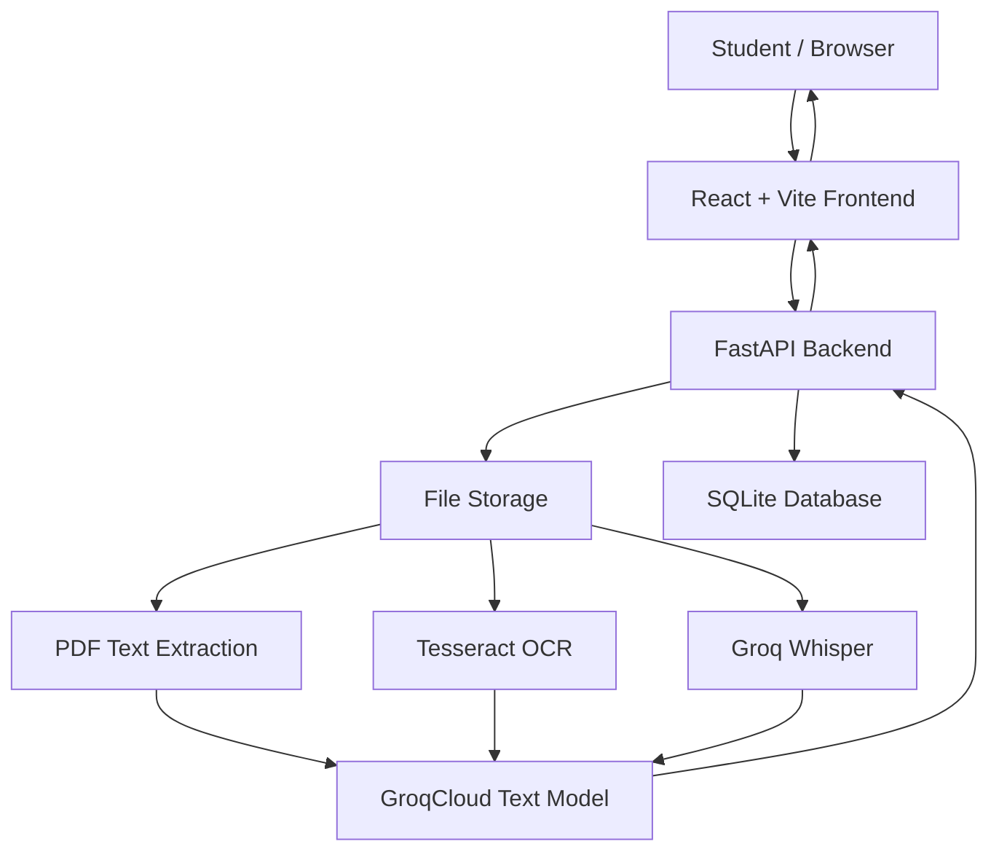

# EduMind AI – Multimodal AI Study Assistant 🎓🤖

**An AI-powered learning assistant that helps students understand, summarize, and practice their study materials using React, FastAPI, and GroqCloud AI.**

EduMind AI transforms uploaded study materials into an interactive learning experience. Students can upload PDF documents, images, and audio recordings, ask questions, generate structured summaries, simplify complex concepts, and practice with AI-generated quizzes.

---

## 🌟 Overview

EduMind AI is a full-stack educational application designed to make studying more interactive and accessible.

Instead of manually going through lengthy notes, students can upload their learning materials and use an AI study assistant to:

- Ask questions about uploaded materials.
- Generate structured study summaries.
- Understand difficult topics through beginner-friendly explanations.
- Generate practice quizzes based on study content.
- Upload and manage PDF, image, and audio materials.

The application uses **GroqCloud AI** for text generation and audio transcription, together with document extraction and OCR technologies.

## 🚀 Features

### 1. Learning Dashboard
- Central dashboard for accessing study tools.
- Quick access to AI chat, summaries, explanations, and quizzes.
- Uploaded study materials overview.
- Easy navigation between application sections.

### 2. Study Material Upload
- Upload PDF documents.
- Upload images: PNG, JPG, JPEG, and WEBP.
- Upload audio recordings: MP3, WAV, M4A, and OGG.
- File size limit: 20 MB per file.
- Material listing and deletion.
- PDF, image, and audio preview support in the frontend.

### 3. AI Study Assistant
- Ask questions about uploaded study materials.
- Context-aware responses based on extracted material content.
- Interactive question-and-answer experience.
- Conversational study support.

### 4. AI Summary Generator
Generate structured summaries from uploaded materials, helping students identify important concepts and revision points.

### 5. Beginner-Friendly Explanations
- Simplifies complex topics.
- Provides step-by-step explanations.
- Uses accessible language and examples.
- Helps students understand unfamiliar concepts.

### 6. AI Quiz Generator
- Generates five multiple-choice questions.
- Four options per question.
- Interactive question-by-question experience.
- Score calculation and answer review.
- Explanations to support learning.

---

## 🧠 AI Processing Architecture

EduMind AI uses different processing techniques depending on the uploaded material.

| Material | Processing technology |
|---|---|
| Text-based PDF | PyMuPDF |
| Scanned PDF | Tesseract OCR |
| Images | Tesseract OCR |
| Audio recordings | Groq Whisper transcription |
| Chat and summaries | GroqCloud text generation |
| Explanations and quizzes | GroqCloud text generation |

**Important:** Image processing currently extracts readable text using OCR. It does not provide complete visual understanding of diagrams or images. Audio is transcribed before the resulting text is processed by the AI text model.

### AI Models

- **Text generation:** `openai/gpt-oss-120b`
- **Audio transcription:** `whisper-large-v3-turbo`
- **AI provider:** GroqCloud

---

## 🛠️ Technology Stack

| Component | Technology |
|---|---|
| Frontend | React 18 |
| Build Tool | Vite |
| Routing | React Router |
| Icons | Lucide React |
| HTTP Client | Axios |
| Backend | Python, FastAPI |
| API Server | Uvicorn |
| AI Provider | GroqCloud |
| AI SDK | Groq Python SDK |
| Text Generation | GPT OSS 120B |
| Audio Transcription | Whisper Large V3 Turbo |
| PDF Extraction | PyMuPDF |
| Image and PDF OCR | Tesseract OCR, Pytesseract |
| Database | SQLite |
| Data Validation | Pydantic |

---

## 🏗️ System Architecture



### Application Flow

1. A student uploads a PDF, image, or audio recording.
2. The FastAPI backend validates and stores the uploaded file.
3. Material metadata is maintained in SQLite.
4. The appropriate extraction or transcription process retrieves the material content.
5. Extracted text is passed to GroqCloud for AI processing.
6. The generated response is returned to the React frontend.

---

## 📁 Project Structure

```text
edumind-ai/
│
├── backend/
│   ├── app/
│   │   ├── main.py
│   │   ├── config.py
│   │   │
│   │   ├── routes/
│   │   │   ├── health.py
│   │   │   └── study.py
│   │   │
│   │   ├── services/
│   │   │   ├── file_service.py
│   │   │   ├── groq_service.py
│   │   │   └── prompt_service.py
│   │   │
│   │   └── schemas/
│   │       └── study.py
│   │
│   ├── requirements.txt
│   ├── .env.example
│   └── grok_service.py
│
├── frontend/
│   ├── public/
│   ├── src/
│   │   ├── components/
│   │   ├── pages/
│   │   ├── services/
│   │   ├── styles/
│   │   ├── App.jsx
│   │   └── main.jsx
│   │
│   ├── index.html
│   ├── package.json
│   └── vite.config.js
│
├── .gitignore
├── README.md
└── TEST_REPORT.md
```

---

## ⚙️ Prerequisites

Install the following before running the application:

1. **Python 3.10 or higher**
2. **Node.js 18 or higher**
3. **npm**
4. **Git**
5. **Tesseract OCR** – required for image and scanned-PDF text extraction.
6. **GroqCloud API key** – required for AI generation and audio transcription.

### Install Tesseract OCR

For Windows, install Tesseract OCR using the UB Mannheim Windows installer:

https://github.com/UB-Mannheim/tesseract/wiki

The default configuration expects:

```text
C:\Program Files\Tesseract-OCR\tesseract.exe
```

If Tesseract is installed in another location, configure `TESSERACT_CMD` in your backend environment file.

### Obtain a GroqCloud API Key

1. Visit https://console.groq.com/
2. Create an account or sign in.
3. Open the API Keys section.
4. Generate an API key.
5. Store it in your backend `.env` file.

Never publish your actual API key.

---

## 🔑 Environment Configuration

Create a file named `.env` inside the `backend` directory.

Use the following configuration as a starting point:

```env
GROQ_API_KEY=your_groq_api_key_here
GROQ_MODEL=openai/gpt-oss-120b
GROQ_AUDIO_MODEL=whisper-large-v3-turbo
TESSERACT_CMD=C:\Program Files\Tesseract-OCR\tesseract.exe
```

Use any additional settings required by your actual `backend/app/config.py` and `.env.example`.

**Security:** Never commit `backend/.env` to GitHub. Keep API keys on the backend only.

---

## 💻 Installation and Running

Clone the repository:

```bash
git clone https://github.com/YOUR_USERNAME/edumind-ai.git
cd edumind-ai
```

Replace `YOUR_USERNAME` with your GitHub username.

### 1. Backend Setup

Open a terminal:

```powershell
cd backend
```

Create and activate a Python virtual environment:

```powershell
python -m venv .venv
.\.venv\Scripts\Activate.ps1
```

Install backend dependencies:

```powershell
python -m pip install -r requirements.txt
```

Configure your `backend/.env` file with your GroqCloud API key.

Start the FastAPI server:

```powershell
python -m uvicorn app.main:app --reload
```

Backend:

http://127.0.0.1:8000

Interactive API documentation:

http://127.0.0.1:8000/docs

Health endpoint:

http://127.0.0.1:8000/api/health

### 2. Frontend Setup

Open a second terminal:

```powershell
cd frontend
```

Install dependencies:

```powershell
npm install
```

Start the development server:

```powershell
npm run dev
```

Frontend:

http://localhost:5173

Keep both development servers running while using the local application.

---

## 📡 API Endpoints

| Method | Endpoint | Description |
|---|---|---|
| GET | `/api/health` | Backend and Groq configuration status |
| POST | `/api/study/upload` | Upload study materials |
| GET | `/api/study/materials` | Retrieve uploaded materials |
| GET | `/api/study/files/{id}/content` | Retrieve material content for preview |
| DELETE | `/api/study/materials/{id}` | Delete a study material |
| POST | `/api/study/chat` | Ask questions about study materials |
| POST | `/api/study/summary` | Generate a study summary |
| POST | `/api/study/explain` | Generate beginner-friendly explanations |
| POST | `/api/study/quiz` | Generate five MCQs |

---

## 🔐 Security and Data Storage

- API keys are configured through backend environment variables.
- API credentials are not intended to be exposed in frontend code.
- Uploaded files are assigned unique identifiers.
- File validation and upload-size restrictions are implemented.
- SQLite stores material metadata.
- Uploaded files are stored separately in the backend uploads directory.
- `.env`, virtual environments, local databases, and uploaded materials are excluded from the Git repository through `.gitignore`.

**Deployment consideration:** The current SQLite and local file-storage setup requires persistent storage in production. Temporary hosting filesystems may be cleared during restarts or redeployments. Configure persistent storage or migrate to managed database and file-storage services before relying on long-term user uploads.

---

## 🚀 Future Enhancements

- Cloud-based file storage.
- Persistent database deployment.
- Improved OCR for handwritten notes.
- Advanced visual understanding of diagrams.
- Flashcard generation.
- Export summaries to PDF.
- Additional language support.
- User authentication and personalized study history.
- Deployment with production monitoring.

---

## 🎓 Project Information

**Project:** EduMind AI – Multimodal AI Study Assistant

**Category:** Artificial Intelligence / Full Stack Development

**Frontend:** React + Vite

**Backend:** Python + FastAPI

**AI Integration:** GroqCloud

**Database:** SQLite

---

## 👨‍💻 Author

**Yalaguresh Ganti**

GitHub: https://github.com/yalaguresh-g

LinkedIn: https://linkedin.com/in/yalaguresh-g

---

## 📄 License

This project is available for educational and learning purposes. Add a license file if you intend to distribute it under specific reuse terms.